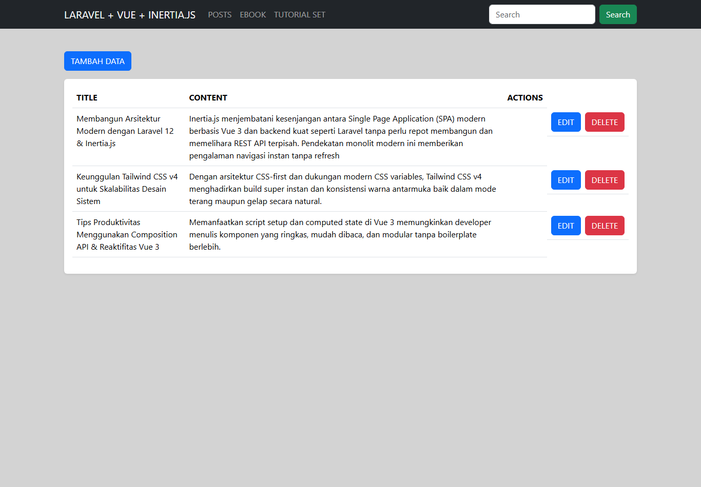
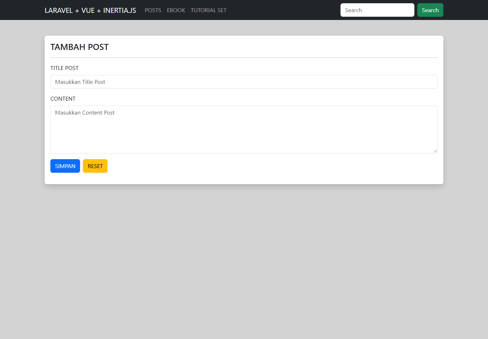

# Tugas Laravel + Inertia.js — CRUD Post

Aplikasi web **CRUD Post** (Create, Read, Update, Delete) yang dibangun dengan **Laravel 12** sebagai backend dan **Inertia.js + Vue 3** sebagai frontend, tanpa perlu membuat REST API terpisah. Styling menggunakan **Tailwind CSS v4** dan bundling asset dengan **Vite**.

Repository tugas: <https://github.com/rafifandriyanto/tugas-Laravel-InertiaJS>

## Tech Stack

| Layer | Teknologi |
| --- | --- |
| Backend | Laravel 12 (PHP 8.2+) |
| Frontend | Vue 3 + Inertia.js 2 (`@inertiajs/vue3`) |
| Styling | Tailwind CSS v4 |
| Bundler | Vite 6 + `laravel-vite-plugin` |
| Database | MySQL |

## Fitur

- **List post** — menampilkan seluruh post terbaru (urut terbaru) dalam bentuk tabel.
- **Tambah post** — form judul & konten dengan validasi server-side (`title` dan `content` wajib diisi).
- **Edit post** — form terisi data post yang dipilih, update dengan validasi.
- **Hapus post** — menghapus post langsung dari tabel.
- **Flash message** — notifikasi sukses setelah simpan / update / hapus ("Data Berhasil Disimpan!", dll).
- **SPA-like navigation** — perpindahan halaman tanpa full reload berkat Inertia.js.

## Screenshot

### Halaman List Post (`/` dan `/posts`)



### Halaman Tambah Post (`/posts/create`)



### Halaman Edit Post (`/posts/{id}/edit`)


## Routes

| Method | URI | Aksi |
| --- | --- | --- |
| GET | `/` | List post (halaman utama) |
| GET | `/posts` | List post |
| GET | `/posts/create` | Form tambah post |
| POST | `/posts` | Simpan post baru |
| GET | `/posts/{id}/edit` | Form edit post |
| PUT/PATCH | `/posts/{id}` | Update post |
| DELETE | `/posts/{id}` | Hapus post |

## Cara Menjalankan

Prasyarat: PHP >= 8.2, Composer, Node.js + npm, dan MySQL yang sudah berjalan.

```bash
# 1. Clone repository
git clone https://github.com/rafifandriyanto/tugas-Laravel-InertiaJS.git
cd tugas-Laravel-InertiaJS

# 2. Install dependency PHP & JavaScript
composer install
npm install

# 3. Siapkan environment
cp .env.example .env
php artisan key:generate

# 4. Sesuaikan koneksi database di .env (default: mysql, db laravel_inertia, user root)
#    DB_CONNECTION=mysql
#    DB_DATABASE=laravel_inertia
#    DB_USERNAME=root
#    DB_PASSWORD=

# 5. Buat database lalu jalankan migrasi
mysql -u root -e "CREATE DATABASE IF NOT EXISTS laravel_inertia"
php artisan migrate

# 6. Build asset frontend (atau `npm run dev` untuk mode development)
npm run build

# 7. Jalankan server
php artisan serve
```

Buka <http://localhost:8000> di browser.

> Mode development sekaligus (server + queue + logs + Vite HMR): `composer run dev`

## Struktur Penting

```
app/Http/Controllers/PostController.php   # Logika CRUD + render Inertia
app/Models/Post.php                       # Model Post (title, content)
resources/js/Pages/Post/Index.vue         # Halaman list post
resources/js/Pages/Post/Create.vue        # Form tambah post
resources/js/Pages/Post/Edit.vue          # Form edit post
routes/web.php                            # Route resource posts
database/migrations/*_create_posts_table.php
```

## Lisensi

Proyek tugas/latihan — bebas digunakan untuk belajar. Framework Laravel berlisensi [MIT](https://opensource.org/licenses/MIT).