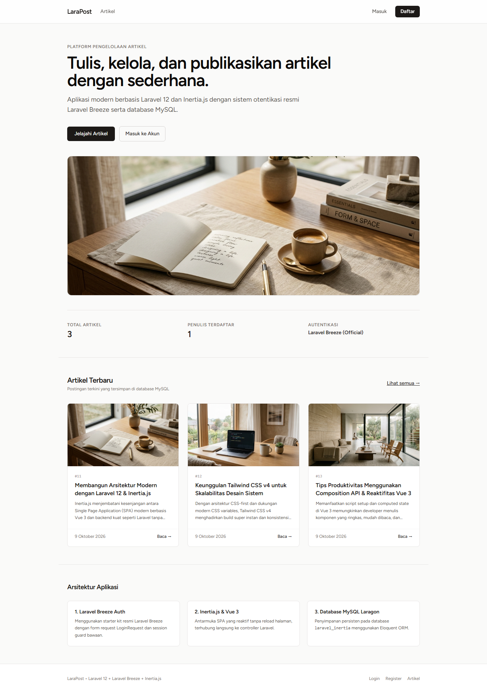
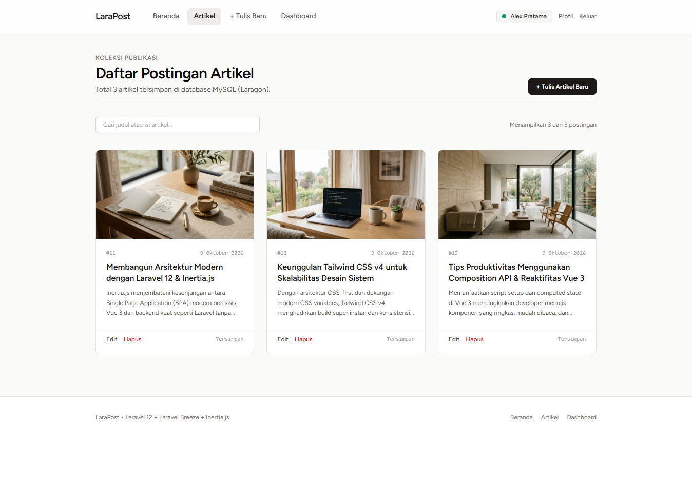
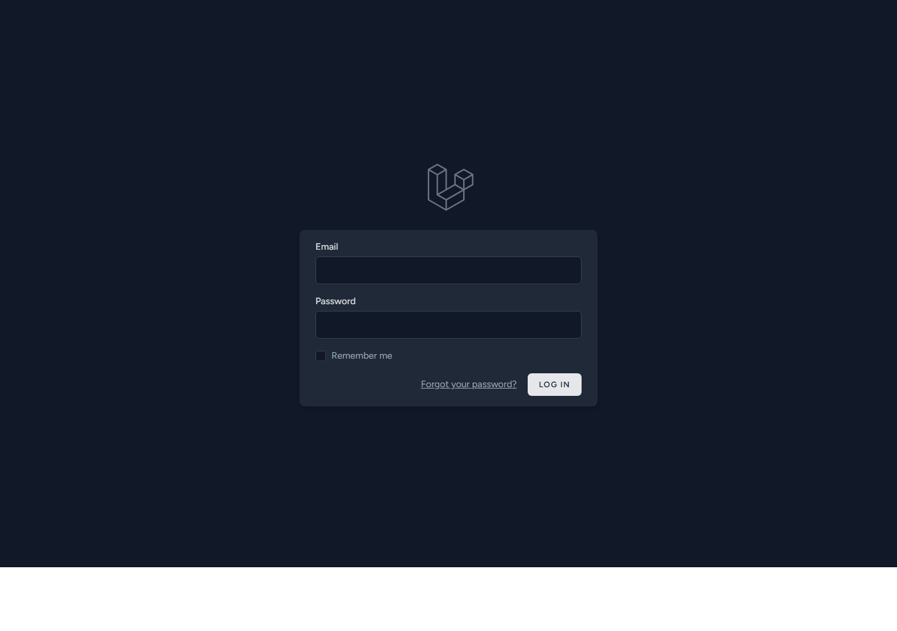
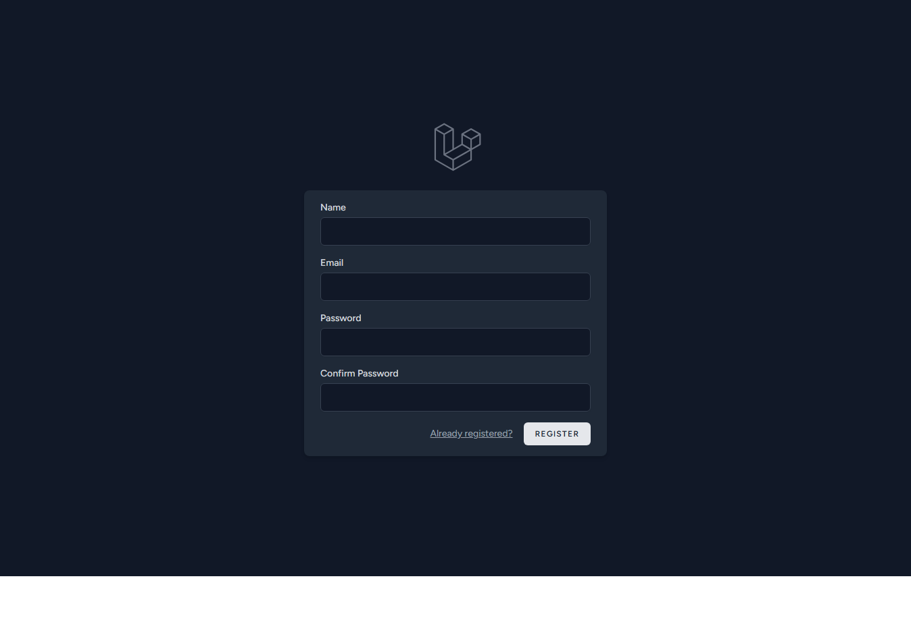
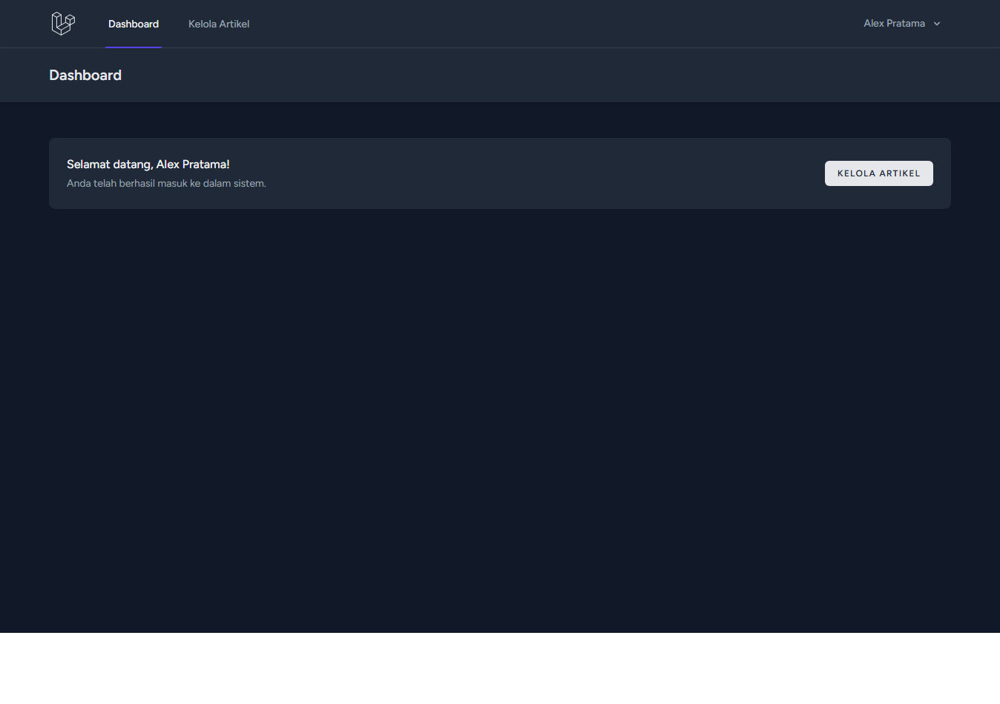
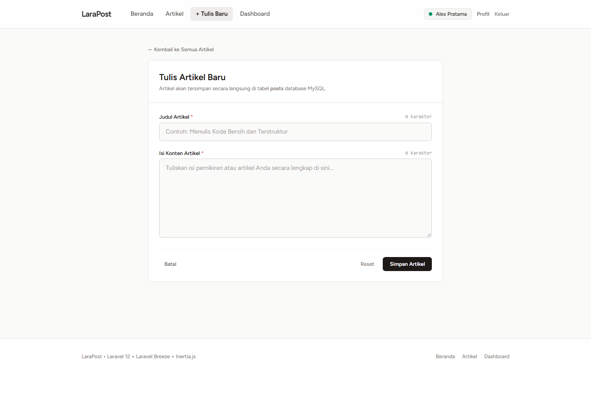
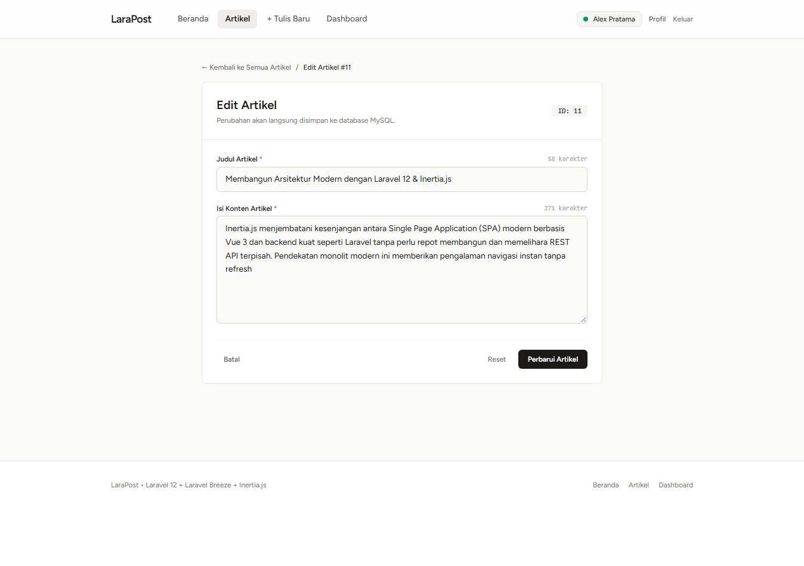
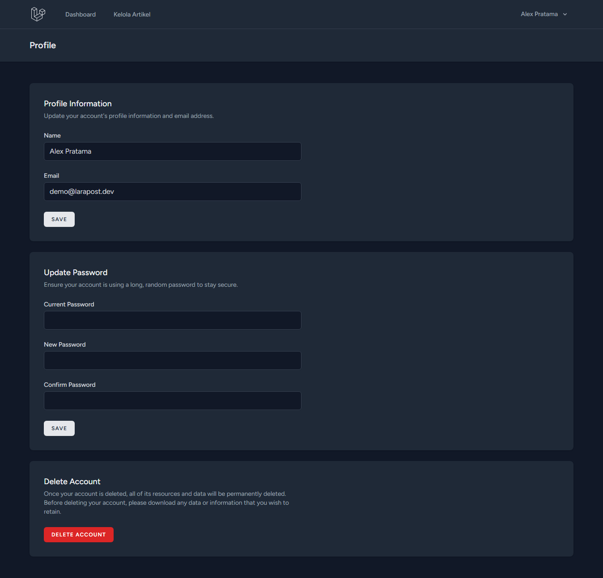

# LaraPost — Tugas Laravel 12 + Inertia.js (Vue 3) + Laravel Breeze

Aplikasi web pengelolaan artikel (**LaraPost**) yang dibangun dengan **Laravel 12**, **Inertia.js + Vue 3**, dan starter kit otentikasi resmi **Laravel Breeze**. Halaman publik (landing page & daftar artikel) bisa diakses tanpa login, sedangkan menulis/mengedit/menghapus artikel serta halaman dashboard dan profil dilindungi middleware `auth`. Styling menggunakan **Tailwind CSS v3** dan bundling asset dengan **Vite**.

Repository tugas: <https://github.com/rafifandriyanto/tugas-Laravel-InertiaJS>

## Tech Stack

| Layer | Teknologi |
| --- | --- |
| Backend | Laravel 12 (PHP 8.2+) |
| Otentikasi | Laravel Breeze (Inertia + Vue scaffolding) |
| Frontend | Vue 3 + Inertia.js 2 (`@inertiajs/vue3`) |
| Styling | Tailwind CSS v3 + PostCSS/Autoprefixer |
| Bundler | Vite 6 + `laravel-vite-plugin` |
| Database | MySQL (Eloquent ORM) |

## Fitur

- **Landing page publik** — hero, statistik (total artikel, penulis terdaftar, jenis otentikasi), kartu artikel terbaru, dan penjelasan arsitektur aplikasi.
- **Daftar artikel publik** (`/posts`) — grid kartu artikel dengan gambar, tanggal, dan ringkasan isi; dilengkapi kolom pencarian judul/isi dan penghitung hasil.
- **CRUD artikel terlindungi auth** — tulis, edit, dan hapus artikel hanya untuk pengguna yang sudah login; validasi server-side via Form Request (`title` & `content` wajib).
- **Otentikasi lengkap Breeze** — register, login, logout, lupa/reset password, dan verifikasi email.
- **Dashboard** (`/dashboard`) — halaman sambutan pengguna terotentikasi (`auth` + `verified`).
- **Manajemen profil** — ubah nama/email, ganti password, dan hapus akun (dengan konfirmasi password).
- **Flash message & navigasi SPA-like** — notifikasi sukses dan perpindahan halaman tanpa full reload berkat Inertia.js.

## Screenshot

### Landing Page (`/`)



### Daftar Artikel (`/posts`)



### Login & Register (Laravel Breeze)





### Dashboard (`/dashboard`, setelah login)



### Tulis Artikel (`/posts/create`)



### Edit Artikel (`/posts/{id}/edit`)



### Profil (`/profile`)



## Routes Utama

| Method | URI | Akses | Aksi |
| --- | --- | --- | --- |
| GET | `/` | publik | Landing page + statistik + artikel terbaru |
| GET | `/posts` | publik | Daftar artikel + pencarian |
| GET | `/posts/create` | auth | Form tulis artikel |
| POST | `/posts` | auth | Simpan artikel |
| GET | `/posts/{post}/edit` | auth | Form edit artikel |
| PUT | `/posts/{post}` | auth | Update artikel |
| DELETE | `/posts/{post}` | auth | Hapus artikel |
| GET | `/dashboard` | auth + verified | Dashboard |
| GET/PATCH/DELETE | `/profile` | auth | Lihat/ubah/hapus profil |
| — | `/login`, `/register`, `/forgot-password`, `/reset-password`, `/verify-email`, `/logout` | sesuai Breeze | Otentikasi (lihat `routes/auth.php`) |

## Cara Menjalankan

Prasyarat: PHP >= 8.2, Composer, Node.js + npm, dan MySQL yang sudah berjalan.

```bash
# 1. Clone repository
git clone https://github.com/rafifandriyanto/tugas-Laravel-InertiaJS.git
cd tugas-Laravel-InertiaJS

# 2. Install dependency PHP & JavaScript
composer install
npm install

# 3. Siapkan environment
cp .env.example .env
php artisan key:generate

# 4. Sesuaikan koneksi database di .env
#    DB_CONNECTION=mysql
#    DB_DATABASE=laravel_inertia
#    DB_USERNAME=root
#    DB_PASSWORD=

# 5. Buat database, migrasi, sekaligus seed akun demo + artikel contoh
mysql -u root -e "CREATE DATABASE IF NOT EXISTS laravel_inertia"
php artisan migrate --seed

# 6. Build asset frontend (atau `npm run dev` untuk mode development + HMR)
npm run build

# 7. Jalankan server
php artisan serve
```

Buka <http://localhost:8000> di browser.

**Akun demo hasil seeder:** `demo@larapost.dev` / `password`

> Mode development sekaligus (server + queue + logs + Vite HMR): `composer run dev`

## Struktur Penting

```
app/Http/Controllers/LandingController.php    # Landing page + statistik
app/Http/Controllers/PostController.php       # CRUD artikel
app/Http/Controllers/ProfileController.php    # Manajemen profil (Breeze)
app/Http/Controllers/Auth/                    # Controller otentikasi Breeze
app/Http/Requests/                            # Validasi Form Request
resources/js/Pages/Landing.vue                # Landing page
resources/js/Pages/Post/                      # Index / Create / Edit artikel
resources/js/Pages/Auth/                      # Login, Register, dll (Breeze)
resources/js/Pages/Profile/                   # Halaman profil (Breeze)
resources/js/Components/                      # Komponen UI Breeze (button, input, modal, dll)
resources/js/Layouts/                         # Layout publik & terotentikasi
routes/web.php, routes/auth.php               # Definisi route
database/seeders/DatabaseSeeder.php           # Akun demo + artikel contoh
public/images/                                # Gambar kartu artikel
```

## Lisensi

Proyek tugas/latihan — bebas digunakan untuk belajar. Framework Laravel berlisensi [MIT](https://opensource.org/licenses/MIT).